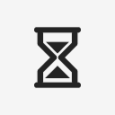

# Hourglass

**One click. One timer.**

A minimal menu bar and system tray timer for macOS and Windows. Click the hourglass to start your timer; right-click to change its duration.

[한국어](README.ko.md) · [Install](#installation) · [Build from source](#build-from-source) · [Contributing](#contributing) · [MIT License](LICENSE)

> **Early MVP:** The Apple Silicon macOS release build, frontend checks, 16 JavaScript tests, 13 Rust tests, formatting, and Clippy pass. The app has been installed in Applications and its login LaunchAgent points to the installed executable. A local Universal macOS build also passes. Native UI interactions, actual login, Windows CI, and public release/Homebrew installation are still pending. See [verification status](BUILD_STATUS.md).

## The idea

Hourglass keeps a single hourglass icon in your menu bar or system tray. There is no main window to manage and no Start button to find. Set a duration once, then start with a click.

The project focuses on a small, local timer: no accounts, servers, database, activity tracking, or Pomodoro statistics.

## Installation

### macOS app

Once a release is published, download the macOS ZIP from this repository's GitHub Releases, extract it, and double-click **Install Hourglass.command** beside **Hourglass.app**. The installer copies the app to `/Applications` (or `~/Applications` if needed) and opens it. Quit an existing Hourglass before an update.

The first installed release launch enables **Launch at startup** automatically. After that, Hourglass appears in the menu bar when you log in. The timer starts when you click the icon. You can disable login startup in settings; later launches respect that choice.

Local packages can be generated with `npm run package:macos`; the app, installer, ZIP, and checksum are written to `dist/`.

### Homebrew

These commands become available after the first public Universal release and the generated Cask have been published:

```sh
brew tap nippyclouding/hourglass https://github.com/nippyclouding/hourglass.git
brew install --cask nippyclouding/hourglass/hourglass
open /Applications/Hourglass.app
```

Homebrew installs the app bundle without Rust or Node.js. Follow Homebrew's external-tap trust prompt. See [release setup](RELEASE.md) for publication and signing requirements; the Homebrew package is not yet live from this development session.

### Install from Git

With the [build prerequisites](#prerequisites) installed:

```sh
git clone https://github.com/nippyclouding/hourglass.git
cd hourglass
npm ci
npm run install:macos
```

On Windows, use `npm run install:windows` instead. This builds and runs the NSIS installer. Launch the installed app once to register login startup.

## How to use it

| Action | Behavior |
| --- | --- |
| Launch Hourglass | Show the hourglass icon without opening a window |
| Left-click while idle | Start a timer using the saved duration |
| Left-click while running | Pause |
| Left-click while paused | Resume |
| Right-click | Open the small settings window |
| Choose **Restart timer** in settings | Reset the current timer to its original duration and run it again |
| Timer completes | Send one system notification and blink the icon every 0.5 seconds for up to 15 seconds |
| Left-click after completion | Dismiss the finished state and stop blinking; click again to start a new timer |

The default duration is **50 minutes**. Enter a whole number of minutes in settings and press **Save**. Changes apply to the next timer; a running or paused timer keeps its current duration. Settings survive app restarts.

The settings window contains:

- **Time** — from 1 to 525,600 minutes.
- **Launch at startup** — start Hourglass when you log in; enabled on the first installed release launch.
- **Save** — save settings and close the window.
- **Restart timer** — restart a running or paused timer from its full original duration and close the window. Unsaved settings are not applied. This action is disabled without an active timer.
- **Quit** — exit Hourglass.

Click outside the settings window or press **Escape** to close it without saving.

While running, the hourglass shows falling grains and gradually transfers sand from top to bottom. The icon updates twice per second. Pausing freezes the animation; restarting returns the sand to the top.

## Platform behavior

| | macOS | Windows |
| --- | --- | --- |
| Icon location | Menu bar | System tray / notification area |
| Remaining time | Next to the icon and in its tooltip | In the icon's tooltip |
| Main window | None | None |
| Dock / taskbar | Hidden | Settings window skips the taskbar |
| Launch at login | LaunchAgent | Windows autostart registration |

Windows may place the icon in the tray's hidden-icons area. Right-click the hourglass there to open settings.

## Build from source

Build on the operating system you want to use. macOS development is initially focused on Apple Silicon; Windows builds use the MSVC toolchain.

### Prerequisites

- **Rust stable, version 1.90 or newer.** Install through [rustup](https://rustup.rs/). The repository's `rust-toolchain.toml` selects stable Rust with Rustfmt and Clippy.
- **Node.js and npm.** The CI configuration uses Node.js 24. Node is used for the development CLI and tests, not as an application runtime.
- **macOS:** Xcode Command Line Tools. Install with `xcode-select --install` if needed.
- **Windows:** Microsoft C++ Build Tools with the **Desktop development with C++** workload and Windows SDK, plus the **WebView2 Runtime**. Use an MSVC Rust toolchain.

See the [official Tauri prerequisites](https://v2.tauri.app/start/prerequisites/) for platform setup. The first build requires internet access to download npm and Cargo dependencies.

### Run in development

Clone this repository and open a terminal in its root directory:

```sh
npm install
npm run dev
```

Find the hourglass in the menu bar or system tray. Right-click it to open settings. Exit using **Quit**, or stop the development process with **Ctrl+C** in the terminal.

### Build a macOS app

```sh
npm run build -- --bundles app
open src-tauri/target/release/bundle/macos/Hourglass.app
```

To also produce a DMG, run `npm run build`. The app bundle is generated under `src-tauri/target/release/bundle/macos/`, and the DMG under `src-tauri/target/release/bundle/dmg/`.

For app installation and launch-at-login registration, run `npm run install:macos`. Autostart is initialized once from the installed app's final location; development and build paths are not registered.

### Build a Windows installer

Run in PowerShell on Windows:

```powershell
npm install
npm run build -- --bundles nsis
```

The installer is generated under `src-tauri/target/release/bundle/nsis/`. Install the app before checking notifications and enabling launch at login.

## Timer behavior and limits

Hourglass stores an end time when a timer starts and computes the remaining time from **end time − current time**. It does not count down by subtracting one second per callback. Time spent asleep or waiting for a delayed callback is included.

- If the timer expires while the computer is asleep, completion is handled after the computer wakes.
- Pausing preserves the remaining duration, including fractions of a second. Resuming creates a new end time.
- Manually changing the system clock affects the remaining time.
- Settings persist; an active timer is not restored after quitting or restarting the app.
- Notifications follow the operating system's notification and focus settings. On Windows, the [Tauri notification plugin](https://v2.tauri.app/plugin/notification/) requires an installed app for proper notifications; development notifications can use a different name and icon.

The Apple Silicon release app bundle is about 3.58 MiB. Before restart and animation were added, two process samples showed 0.0% CPU and approximately 95–100 MiB RSS. Those brief observations are not a benchmark of the current build; native UI behavior and animated runtime resource use still need verification.

## Implementation

The app uses **Tauri 2.12.3**, **Rust**, and plain **HTML, CSS, and JavaScript**. There is no frontend framework, bundler, or development server. The sole npm development dependency is Tauri CLI 2.12.2; dependency versions are declared in [Cargo.toml](src-tauri/Cargo.toml) and [package.json](package.json).

Rust owns the timer, tray events, notifications, and settings. The settings WebView is created on demand and released when closed. The timer worker waits while idle, paused, or finished. While running, it animates pre-rendered icon frames every 0.5 seconds and updates the countdown only when the displayed time changes. Completion blinking uses the same worker and is bounded to 15 seconds.

Official Tauri plugins provide local settings storage, autostart, notifications, and single-instance handling. Platform-specific presentation is isolated in `platform.rs`.

```text
ui/                       Small settings interface
src-tauri/src/main.rs      App lifecycle and settings commands
src-tauri/src/timer.rs     Deadline-based state machine and tests
src-tauri/src/tray.rs      Tray events, display, notifications, worker
src-tauri/src/settings.rs  Persistent settings and autostart
src-tauri/src/platform.rs  Platform-specific presentation
src-tauri/Info.plist       macOS Dock visibility
assets/hourglass.svg       Hourglass icon source
scripts/generate-icons.py  Reproducible icon generator
tests/                    Frontend behavior tests
```

Generated icons are included in the repository. Python is only needed to regenerate them with `python3 scripts/generate-icons.py`; the generator uses the Python standard library.

## Contributing

Bug reports, small fixes, and macOS/Windows testing are welcome. Please keep changes focused on the one-click timer and its small settings interface.

For a bug report, include your OS version, app version or commit, development or installed-app mode, reproduction steps, and expected versus actual behavior.

Before submitting a pull request, run:

```sh
npm run check
npm test
cargo fmt --manifest-path src-tauri/Cargo.toml
cargo test --manifest-path src-tauri/Cargo.toml
cargo clippy --manifest-path src-tauri/Cargo.toml --all-targets -- -D warnings
```

Build on the affected platform and use the [native testing checklist](TESTING.md) for tray interactions, sleep/resume, blinking, notifications, and autostart. Frontend tests do not verify those native behaviors.

The [GitHub Actions workflow](.github/workflows/build.yml) is configured to run checks and produce macOS `.app` and Windows NSIS artifacts. Its presence does not indicate that those builds have passed. The generated `package-lock.json` and `src-tauri/Cargo.lock` are included; keep both in version control for reproducible dependency resolution.

## License

Hourglass is open source under the [MIT License](LICENSE).
